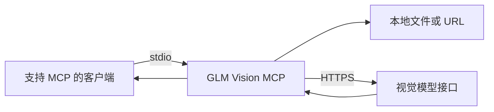

# GLM Vision MCP

一个基于 TypeScript 的 MCP 服务，将视觉模型接口封装为 AI 客户端可以调用的工具。支持本地图片、远程媒体、OCR，以及视频与文件分析请求。

**工程重点：** stdio 协议集成、媒体输入转换、参数校验、请求超时与结构化错误返回。



## 工具

| 名称 | 功能 |
|---|---|
| `analyze_image` | 单图理解与自定义提问 |
| `analyze_images` | 最多 6 张图片的对比分析 |
| `ocr_image` | 提取图片文字 |
| `analyze_video` | 提交视频分析请求 |
| `analyze_file` | 提交 PDF 或其他文件的分析请求 |

媒体类型能否被处理、输入大小及输出质量取决于所配置的模型接口。文件与视频支持尚需针对具体提供商验证。

## 本地运行

需要 Node.js 22 或更新版本。

```sh
npm ci
npm run build
npm test
```

在 MCP 客户端中配置以下示例，将路径改为本机绝对路径，将 Key 放在自己的本地配置中：

```json
{
  "mcpServers": {
    "glm-vision": {
      "command": "node",
      "args": ["/absolute/path/mcp-glm-vision/dist/index.js"],
      "env": {
        "ZHIPU_API_KEY": "your-api-key"
      }
    }
  }
}
```

环境变量：`ZHIPU_API_KEY`（必需）、`GLM_MODEL`、`GLM_API_URL`、`GLM_TIMEOUT_MS`。默认模型为 `glm-4.6v-flash`，默认超时为 120 秒。额度和价格以提供商当前说明为准。

`.env` 文件不会被服务自动加载。直接调试时可以使用 Node 的 `--env-file`：

```sh
node --env-file=.env scripts/demo.js test-assets/test.png "请描述图片"
```

## 关键实现

- [src/index.ts](src/index.ts)：工具声明、请求分发与参数检查。
- [src/glm.ts](src/glm.ts)：本地文件转 data URL、媒体消息构造、HTTP 请求与超时处理。
- [scripts/test-server.js](scripts/test-server.js)：启动子进程，验证初始化、工具发现和缺少 Key 的错误路径。

本地文件会读取并编码后发送到模型提供商；仅应输入你有权处理的文件。本地大文件在编码后超过限制时会返回错误。当前 HTTP 超时覆盖等待响应头的阶段，尚未覆盖响应体读取全过程。

## 验证范围

协议冒烟测试与 TypeScript 构建不需要 API Key。示例测试图片为 1×1 像素，只用于请求链路测试，不能作为识别效果评估。真实模型输出没有包含在自动化测试结果中。

来源与署名见 [SOURCE_AND_CREDITS.md](SOURCE_AND_CREDITS.md)。
